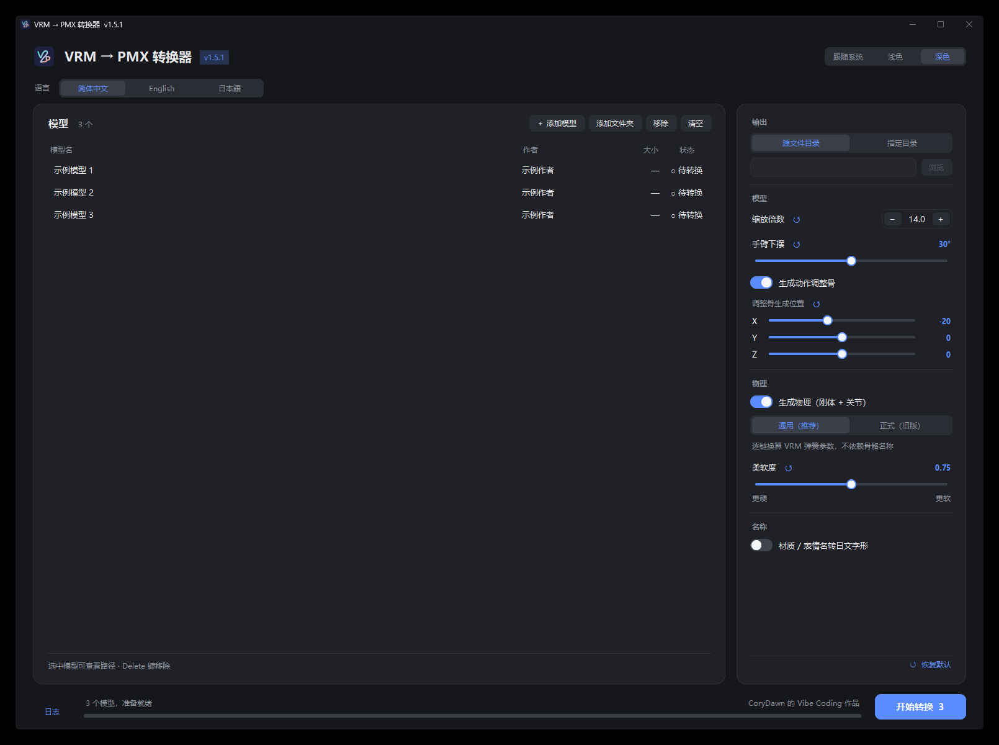
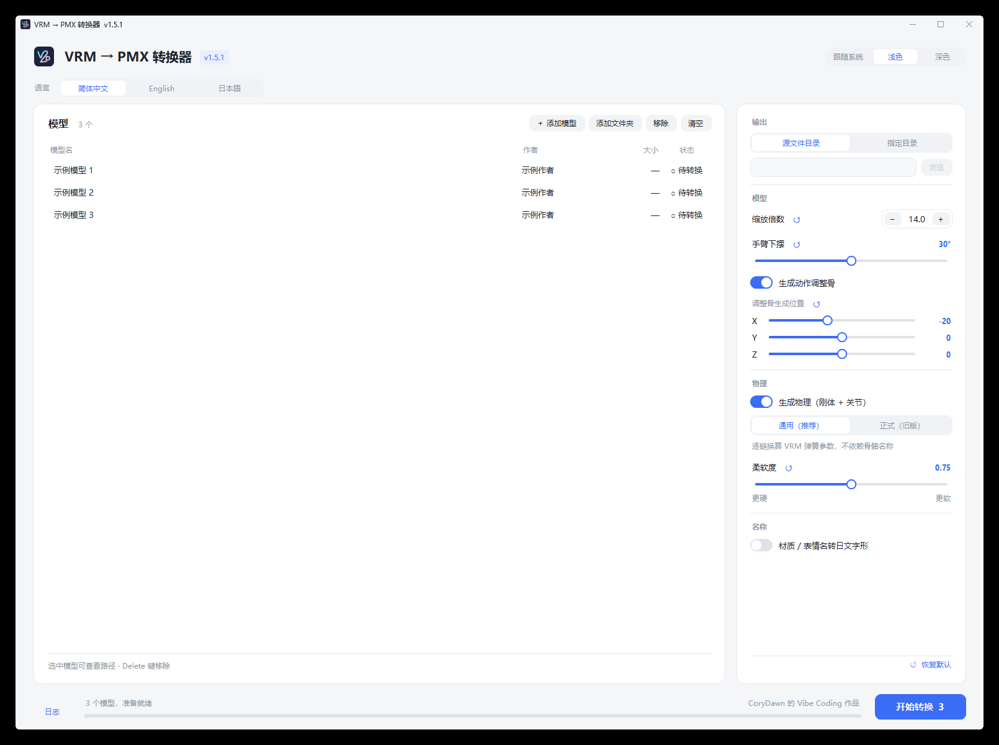

# VRM → PMX Converter

[简体中文](README.md) | **English** | [日本語](README.ja.md)

A free, open-source Windows tool that converts VRM 0.x character models exported by UniVRM into PMX models for MikuMikuDance (MMD).

## Features

- **Common MMD bones:** Creates standard and common auxiliary bones to reduce manual setup.
- **Optional motion adjustment bones:** Adds controls for the arms, torso, legs and feet. Set their position and use keyframes to manually correct motion and clipping.
- **Optimized physics:** Converts VRM spring-bone parameters into MMD physics, with adjustments intended to reduce jitter and follow-up work.
- **Organized morph panel:** Classifies morphs by name; unrecognized names are placed under “Other.”
- **Material morphs:** Converts some material color and transparency changes, including transparency-based visibility switches.
- **Texture reuse:** Reuses the exported file when multiple materials reference the same texture.
- **Inherited material settings:** Converts VRM material outlines and double-sided settings.
- **Optional name conversion:** Converts some Chinese characters in material and morph names to Japanese forms to reduce garbled text.
- **Easy to use:** Drag and drop files or add them in batches. Choose a light or dark theme and, when available in your version, Simplified Chinese, English or Japanese for the interface. The Windows package is about 66 MB and does not require Python to run.

Results depend on the model, materials and motion; physics, outlines and morphs may not match every source exactly. Check the converted model in MMD or PMX Editor. Name conversion changes names and can affect morph tracks in existing motions.

## Interface



<details>
<summary>View the light theme</summary>



</details>

The screenshots show v1.5.1 with sample model and author names; the interface may vary by version. Where the language selector is available, it appears at the top of the main window. Language selection is saved, and does not change model names or the separate name-conversion option.

## Download and use

Download the latest ZIP from [Releases](https://github.com/Cory-Dawn/VRM-PMX-Converter/releases/latest), extract it and run `VRM2PMX.exe`. Add VRM models, choose the output and conversion options, and start conversion. For details, see the [user guide (Chinese)](使用说明.md).

Conversion involves bones, morphs, materials, textures and physics. Check the result in MMD or PMX Editor and follow the model author's terms of use.

## Run from source

Windows requires Python 3.13 or 3.14:

```powershell
py -3.14 -m pip install -r requirements.txt
py -3.14 main.py
```

Command-line use:

```powershell
py -3.14 -m vrm2pmx.cli "input.vrm" -o "output_directory"
```

## Build for Windows

For example, with Python 3.13, install the dependencies and PyInstaller, then run:

```powershell
py -3.13 -m pip install -r requirements.txt pyinstaller
py -3.13 -m PyInstaller --noconfirm --clean VRM2PMX.spec
py -3.13 -m PyInstaller --noconfirm --clean VRM2PMX-CLI.spec
```

The executables are placed in `dist/`. The v1.5.1 release was built with Python 3.13.17, NumPy 2.5.4, Pillow 13.0.0, pypinyin 0.55.0, tkinterdnd2 0.7.0 and PyInstaller 6.22.3.

The source icon is `assets/VRM2PMX.svg`; run `py -3.13 dev/make_icon.py` to regenerate the PNG and ICO.

## License and third-party notices

Copyright (c) 2026 CoryDawn. Project code is licensed under [GNU GPL v3.0 only](https://github.com/Cory-Dawn/VRM-PMX-Converter/blob/main/LICENSE) (GPL-3.0-only).

Parts of the physics implementation were ported from [UniVRM](https://github.com/vrm-c/UniVRM) and [PMXExporter](https://github.com/lispcoc/VRM2PMX-Unity/tree/master/Assets/PMXExporter). The adjustment-bone local-axis handling references [MMD Tools](https://github.com/MMD-Blender/blender_mmd_tools). See the [third-party notices](https://github.com/Cory-Dawn/VRM-PMX-Converter/blob/main/THIRD_PARTY_NOTICES.md) and `LICENSES/` for details.

## Support the author

The software is free to use and support is entirely optional. If it helped you, consider buying the author a coffee!

[Support CoryDawn on Afdian](https://afdian.com/a/CoryDawn)
