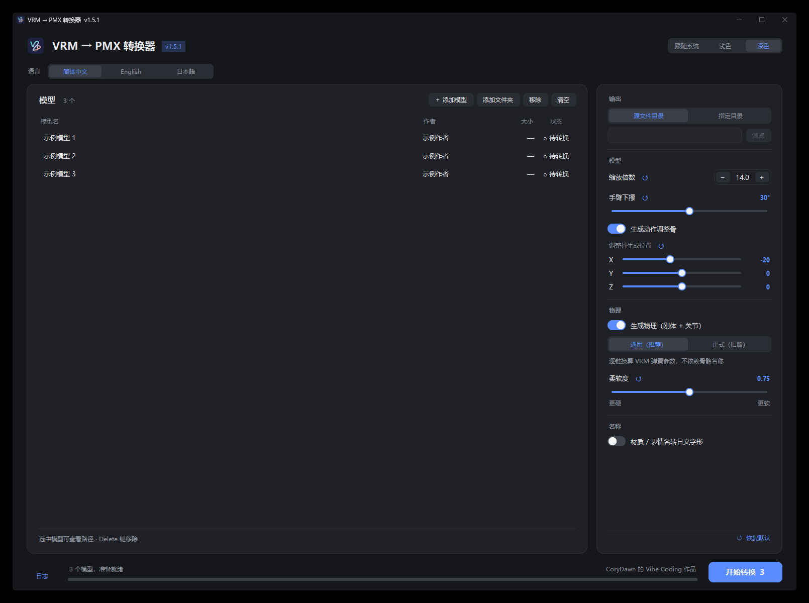
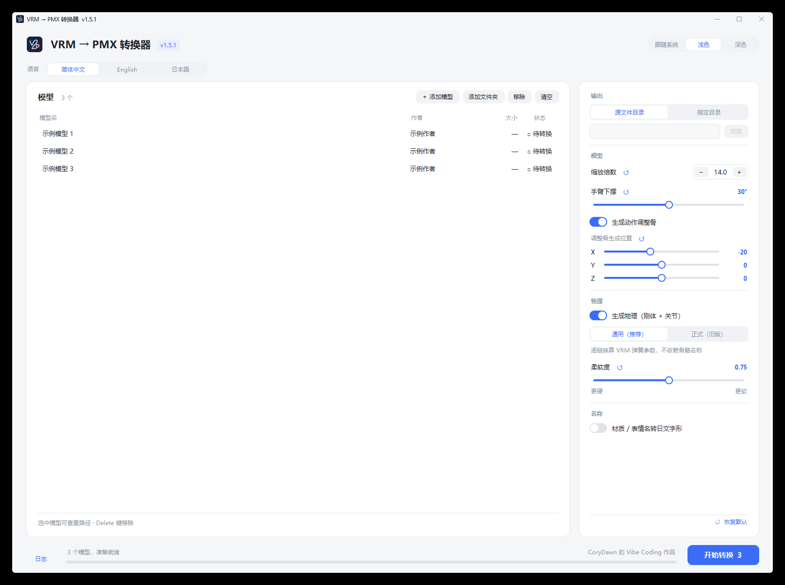

# VRM → PMX コンバーター

[简体中文](README.md) | [English](README.en.md) | **日本語**

UniVRM から出力した VRM 0.x キャラクターモデルを、MikuMikuDance（MMD）で使える PMX モデルに変換する、無料・オープンソースの Windows ツールです。

## 主な特徴

- **一般的な MMD ボーンを生成：** 標準ボーンとよく使う補助ボーンを作成し、手動で追加する作業を減らします。
- **動作調整ボーンを選択して生成：** 腕、胴体、脚、足などの調整用コントロールを作成します。位置を指定でき、キーフレームによるモーションやめり込みの手動修正に役立ちます。
- **物理演算を最適化：** VRM のスプリングボーン設定から MMD 用の物理を生成し、揺れの乱れや後調整を減らすように調整します。
- **表情パネルを整理：** モーフ名に応じて自動分類します。判別できないものは「その他」に入ります。
- **材質モーフに対応：** 材質の色や透明度の変化の一部を変換します。透明度による表示切り替えも含みます。
- **テクスチャを再利用：** 複数の材質が同じテクスチャを参照する場合、出力ファイルを共用します。
- **材質設定を継承：** VRM の材質設定に応じてエッジを生成し、両面表示の設定を引き継ぎます。
- **名前の字形を変換可能：** 材質・モーフ名の中国語の一部を日本語で使われる字形に変換し、文字化けを軽減します。
- **手軽に操作：** ドラッグ＆ドロップと一括追加に対応し、ライト・ダークテーマを選べます。対応バージョンでは画面言語を簡体字中国語・英語・日本語から選択できます。Windows 版は約 66 MB で、実行に Python のインストールは不要です。

モデルの構造、材質、モーションによって結果は異なります。物理、エッジ、モーフがすべてのモデルで完全に一致するとは限りません。変換後は MMD または PMX Editor で確認してください。名前を変換すると、既存モーションのモーフトラックに影響する場合があります。

## 画面



<details>
<summary>ライトテーマの画面を見る</summary>



</details>

画像は v1.5.1 の画面で、モデル名と作者名はデモ用です。画面はバージョンによって異なる場合があります。言語切り替えに対応するバージョンでは、メイン画面上部から選択できます。選択した言語は保存され、モデル内の名前や、別の名前変換オプションには影響しません。

## ダウンロードと使い方

[Releases](https://github.com/Cory-Dawn/VRM-PMX-Converter/releases/latest) から最新の ZIP をダウンロードし、展開して `VRM2PMX.exe` を実行します。VRM モデル、出力先、変換オプションを選んで変換を開始してください。詳細は[使用説明（中国語）](使用说明.md)を参照してください。

ボーン、モーフ、材質、テクスチャ、物理を変換します。結果を MMD または PMX Editor で確認し、モデル作者の利用規約に従ってください。

## ソースから実行

Windows では Python 3.13 または 3.14 が必要です。

```powershell
py -3.14 -m pip install -r requirements.txt
py -3.14 main.py
```

コマンドラインで実行する場合：

```powershell
py -3.14 -m vrm2pmx.cli "input.vrm" -o "output_directory"
```

## Windows 版のビルド

Python 3.13 の例では、依存ライブラリと PyInstaller をインストールしてから実行します。

```powershell
py -3.13 -m pip install -r requirements.txt pyinstaller
py -3.13 -m PyInstaller --noconfirm --clean VRM2PMX.spec
py -3.13 -m PyInstaller --noconfirm --clean VRM2PMX-CLI.spec
```

実行ファイルは `dist/` に生成されます。v1.5.1 の配布版は Python 3.13.17、NumPy 2.5.4、Pillow 13.0.0、pypinyin 0.55.0、tkinterdnd2 0.7.0、PyInstaller 6.22.3 でビルドされました。

アイコンの元ファイルは `assets/VRM2PMX.svg` です。`py -3.13 dev/make_icon.py` で PNG と ICO を再生成できます。

## ライセンスと第三者の権利表示

Copyright (c) 2026 CoryDawn。プロジェクトのコードには [GNU GPL v3.0 のみ](https://github.com/Cory-Dawn/VRM-PMX-Converter/blob/main/LICENSE)（GPL-3.0-only）が適用されます。

物理実装の一部は [UniVRM](https://github.com/vrm-c/UniVRM) と [PMXExporter](https://github.com/lispcoc/VRM2PMX-Unity/tree/master/Assets/PMXExporter) から移植しています。調整ボーンのローカル軸処理は [MMD Tools](https://github.com/MMD-Blender/blender_mmd_tools) を参考にしています。詳細は[第三者の権利表示](https://github.com/Cory-Dawn/VRM-PMX-Converter/blob/main/THIRD_PARTY_NOTICES.md)と `LICENSES/` を参照してください。

## 作者を支援

ソフトは無料で使用でき、支援は任意です。役に立ったと感じたら、作者にコーヒーを一杯おごっていただけると嬉しいです。

[Afdian で CoryDawn を支援する](https://afdian.com/a/CoryDawn)
